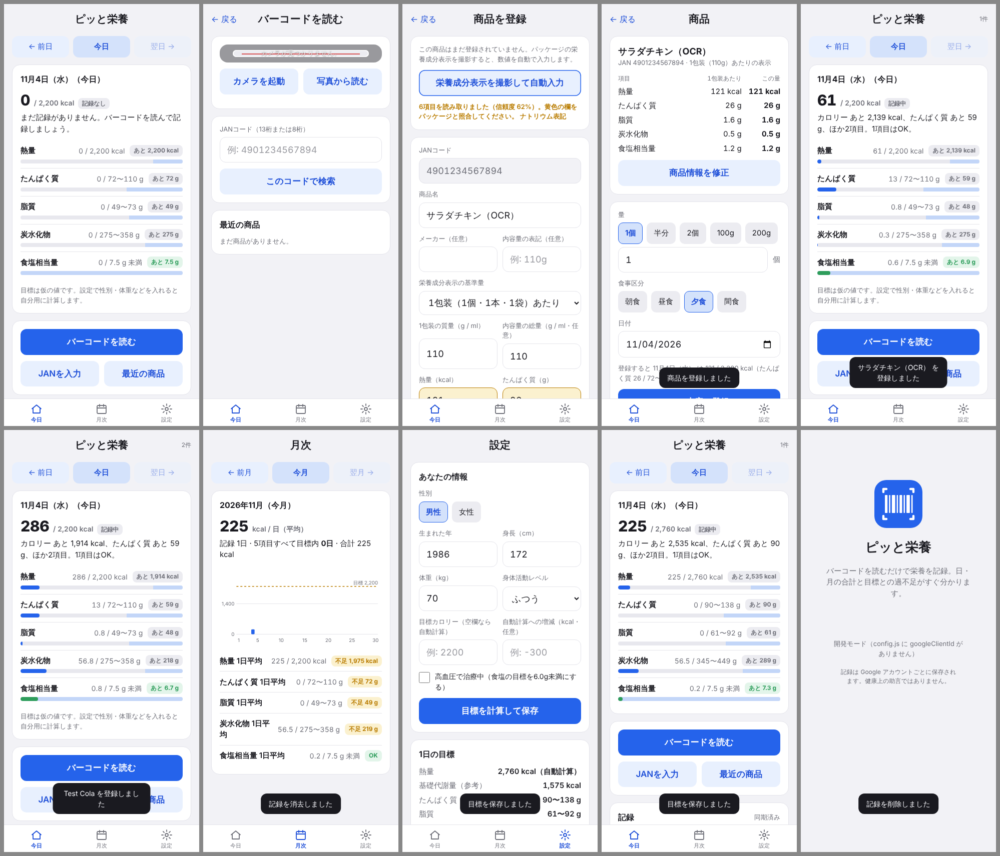

# ピッと栄養（GAS 版）

バーコードを読むだけで食品の栄養を記録し、日・月の合計と目標に対する過不足を一目で確認するアプリです。
設計書「カロリー・栄養計算アプリ 設計書」の v1 構成（**GitHub Pages の静的 PWA + GAS Web App の JSON API + Google スプレッドシート**）をそのまま実装しています。



## 構成

```
pitto-eiyo/
├─ shared/logic.js      共通ロジック（目標算出・判定・総括文・量の換算・JAN検証）。純粋関数のみ
├─ gas/                 Google Apps Script（API + DB + 外部連携）
│   ├─ Code.gs          doGet / doPost、action ルーティング、{ ok, data, error } の応答
│   ├─ Auth.gs          Google ID トークン検証（tokeninfo + CacheService）、開発モード、利用者制限
│   ├─ Db.gs            スプレッドシートをテーブルとして扱う層（7タブ）、LockService、型の正規化
│   ├─ Products.gs      商品マスタ（照会・登録・修正・修正提案・最近の商品）
│   ├─ External.gs      Open Food Facts API v2 / Yahoo!ショッピング商品検索 API
│   ├─ Logs.gs          食事記録（client_id で冪等、栄養5項目のスナップショット）
│   ├─ Summary.gs       日次サマリの差分更新、月次集計、夜間の全件再計算トリガー
│   ├─ Profile.gs       プロフィール・目標、退会（物理削除）
│   ├─ Sync.gs          起動時の一括同期（sync.bootstrap）
│   ├─ Ocr.gs           栄養成分表示の写真 → 5項目（Claude / Gemini、プロパティで切替）
│   ├─ logic.js         shared/logic.js のコピー
│   ├─ appsscript.json  マニフェスト（V8、Asia/Tokyo、Web アプリ設定、スコープ）
│   ├─ bundle/          Code.gs（全 .gs + logic.js を 1 ファイルにまとめたもの。`npm run bundle` で生成）と appsscript.json
│   └─ test/            Node 上のモック（mock-gas.js）、API シナリオテスト、ローカル開発サーバ
├─ web/                 フロント（素の HTML / CSS / JS、ビルド不要。GitHub Pages にそのまま置く）
│   ├─ index.html, styles.css, app.js   画面（プロトタイプの青系デザインを踏襲）
│   ├─ api.js           GAS 呼び出し（POST text/plain、token、{ ok, data, error }）
│   ├─ auth.js          Google Identity Services ログイン / 開発モード
│   ├─ store.js         localStorage キャッシュ、未送信キュー
│   ├─ scanner.js       ライブスキャン（BarcodeDetector → ZXing フォールバック）、写真読取、画像縮小
│   ├─ config.js        API の URL と OAuth クライアント ID（デプロイ時に編集）
│   ├─ manifest.webmanifest, sw.js, icons/   PWA（ホーム画面追加、アプリ本体のオフライン表示）
│   └─ vendor/          @zxing/library 0.21.3（Apache-2.0）
├─ tests/               共通ロジックの単体テスト、Playwright の E2E
└─ scripts/             共通ロジックの同期、アイコン生成
```

## 全体像と更新のしかた（次に手を入れる人へ）

### どこに何があるか

| 層 | 場所 | 中身 | 更新のしかた |
| --- | --- | --- | --- |
| フロント（PWA） | `web/` → GitHub Pages `https://kentaro-php.github.io/pitto-eiyo/` | 画面・バーコード読取・端末キャッシュ・Google ログイン | `main` に入ると `.github/workflows/pages.yml` が 1〜2 分で公開。`web/app.js` などを変えたら **`web/sw.js` の `VERSION` も上げる**（上げないと既存端末に新しい JS が配られない） |
| API | `gas/` → Apps Script プロジェクト「ピッと栄養 API」（スプレッドシートに紐づく） | 認証・商品マスタ・記録・集計・外部照会・OCR | 正本は GitHub。変更後に `npm run bundle` → `gas/bundle/Code.gs` を Apps Script の `コード.gs` に全文貼り直し →「デプロイ → デプロイを管理 → 鉛筆 → バージョン: 新バージョン → デプロイ」。**「新しいデプロイ」は使わない**（exec URL が変わり `web/config.js` の書き換えが必要になる） |
| 共通ロジック | `shared/logic.js` | 目標算出・判定・換算・JAN 検証・検索語の正規化。純粋関数のみ | ここだけを編集し `npm run sync` で `web/logic.js` と `gas/logic.js` にコピー（直接編集しない） |
| データ | Google スプレッドシート「ピッと栄養 DB」（7 タブ、`gas/Db.gs` の `SCHEMA` が列定義） | users / user_profiles / products / food_logs / daily_summaries / product_images / product_suggestions | 列を増やすときは `SCHEMA` 末尾に追加し、既存シートにも手で列を足す。削除は `deleted_at` を入れる論理削除 |
| 設定・鍵 | Apps Script「プロジェクトの設定 → スクリプト プロパティ」 | API キー・クライアント ID・利用者制限・機能スイッチ（下の表） | コミットしない。保存した瞬間から有効で再デプロイ不要 |
| 標準食品データ | `gas/Foods.gs` | 手料理・一般食品の定義（八訂の 100 g 値＋1 食の目安量＋レシピ） | 品目を足したら bundle → 貼り直し → `setupFoods` を再実行（冪等。既存行は標準値に戻る） |

### 商品データの出どころ（照会順）

バーコードを読むと `product.get` が次の順に探し、見つかった時点で返します。

1. **自前の商品マスタ**（`products` タブ）— 一度見つかった商品は全員で共有。`source` 列で出どころを区別
   - `manual` 手入力 / `ocr` 栄養成分表示の写真から / `off` Open Food Facts / `web` ウェブ照会 / `food` 標準成分表（手料理）
2. **Open Food Facts API v2**（無料・ODbL）— 日本の商品はほぼ無い。100 g 当たりで保存
3. **Yahoo!ショッピング 商品検索 API**（`YAHOO_CLIENT_ID` があるとき）— 商品名のみ
4. **ウェブ照会**（`CLAUDE_API_KEY` があるとき。`gas/External.gs` の `webLookup`）— Claude Messages API に `web_search` / `web_fetch` を渡し、メーカー公式・通販ページの商品名と栄養成分表示を JSON で読む。5 項目そろって信頼度 0.7 以上なら `source=web` で保存して即表示、それ以外は登録フォームの初期値（黄色＝要確認、出典リンク付き）。ログイン済みの呼び出しだけ実行、同じ JAN は 6 時間キャッシュ、`WEB_LOOKUP_DAILY_LIMIT`（既定 100 回／日）で停止。**有料**（検索 1 回 $0.01 ×最大 4 ＋トークン代。1 JAN あたり数円〜十数円。2 回目以降はマスタから無料）
5. それでも無ければ **登録フォーム** — 栄養成分表示を撮影して OCR（`CLAUDE_API_KEY`、または `OCR_PROVIDER=gemini` と `GEMINI_API_KEY`）か手入力

バーコードが無い・読めない商品（パン屋・お惣菜・外食など）は、ホームまたはスキャン画面の「手入力で登録」から名前と栄養成分（熱量だけでも可）を登録します。JAN の代わりに `custom:<id>` をサーバが振り（`shared/logic.js` の `isCustomJan`）、`source` は `manual` / `ocr`。**登録した本人の検索・最近の商品にだけ出ます**（`products.search` と `products.recent` が `created_by` で絞る）。

手料理・一般食品（ご飯・みそ汁など約 80 品）は **文部科学省「日本食品標準成分表（八訂）増補2023年」第2章** の可食部 100 g 当たりの値（食品番号を `gas/Foods.gs` の `PER100` に併記）に、一般的な 1 食の目安量（茶碗 1 杯 150 g、卵 1 個 50 g、お椀 1 杯など）を掛けたものです。みそ汁・カレーライス・卵かけご飯・野菜サラダなどは `RECIPES`（食材と g）から合算しています。出典: https://www.mext.go.jp/a_menu/syokuhinseibun/mext_00001.html （政府標準利用規約 2.0）。

### 変更の手順（毎回同じ）

1. GitHub Issue を立てる → ブランチを切る → 変更 → `npm test`（Node のモックで GAS API のシナリオテストが走る）→ 必要なら `npm run sync` と `npm run bundle` → PR
2. レビュー（Codex）→ マージ
3. `web/` の変更は Actions が自動公開。スマホは PWA を開き直す（`sw.js` の `VERSION` を上げてあれば自動で入れ替わる）
4. `gas/` の変更は上の表のとおり Apps Script に貼り直して **新バージョン**でデプロイ。`selfCheck` を実行して `"ok":true` を確認
5. データ移行が要るもの（`setupFoods` など）は、その関数をエディタから実行

### 日常の確認ポイント

- `exec?action=health` が `{"ok":true,...}`、Apps Script「実行数」にエラーが無いか
- `products` の `source=web` 行（AI 取得・要確認）と `product_suggestions`（他ユーザーからの修正提案）を月 1 回眺めて、変な値は「商品情報を修正」で直す（`ADMIN_EMAILS` に入っていればその場で反映）
- ウェブ照会の回数は `WEB_LOOKUP_COUNT`（`yyyy-MM-dd:n`）、費用は Anthropic Console の Usage
- 他人に URL を渡す前に `DEBUG=0`、`AUTH_MODE=google`、`ALLOWED_EMAILS` を確認

### 更新履歴

- 2026-11-05 初期セットアップ（スプレッドシート・GAS v1・GitHub Pages・Google ログイン）。リポジトリは Pages のため public
- 2026-11-05 PR #1 ウェブ照会（未登録 JAN の商品名・栄養成分を Claude の web_search / web_fetch で取得）。GAS v2
- 2026-11-05 PR #2 手料理・一般食品の検索（八訂ベース 77 品、`setupFoods`、`products.search`）。GAS v3→v4（レビュー対応）
- 2026-11-05 PR #3 README に全体像・データの出どころ・更新手順を追記
- 2026-11-05 PR #4 バーコードの無い商品の手入力登録（`custom:<id>`、本人だけに表示）。GAS v5、SW v3

## 設計書との対応

| 設計書 | 実装 |
| --- | --- |
| F1 バーコード読取（連続読取・手入力） | `web/scanner.js`。BarcodeDetector 対応端末はそれを使い、iOS Safari など未対応端末は ZXing で中央の帯を 1 秒に約 6 回デコード。同じ値が 2 回続いたら確定。写真からの読取と 13 桁手入力も可 |
| F2〜F6 商品表示・記録・日次/月次集計・総括判定 | `shared/logic.js` + `gas/Logs.gs` `gas/Summary.gs`。判定の表・総括文のテンプレートは設計書 8 節どおり |
| F7 目標設定 | `computeTargets`（基礎代謝基準値 × 体重 × 身体活動レベル、PFC バランス、食塩目標、高血圧オプション、手動上書き、増減 kcal） |
| F13 手料理・一般食品の入力 | ホームの「料理・食品を検索」で、ご飯・みそ汁・納豆・焼き鮭など約 80 品を名前・読みで検索して記録（`gas/Foods.gs`）。値は文部科学省「日本食品標準成分表（八訂）増補2023年」の 100 g 当たりに 1 食の目安量（茶碗 1 杯 150 g など）を掛けたもの。みそ汁・カレーライス・卵かけご飯などは食材の分量から合算。`setupFoods` で登録・更新 |
| F14 バーコードの無い商品の手入力 | ホーム／スキャン画面の「手入力で登録」。名前と栄養成分（熱量だけでも可）を入れると JAN の代わりに `custom:<id>` が振られ、本人の検索・最近の商品から再記録できる。栄養成分表示の撮影（OCR）も使える |
| F8 未登録商品のフォールバック | 自前マスタ → Open Food Facts → Yahoo!（商品名のみ）→ ウェブ照会（Claude の web_search / web_fetch でメーカー・通販ページの商品名と栄養成分表示を読む。確からしければ `source=web` で自動保存、そうでなければ登録フォームの初期値）→ OCR 登録 / 手入力。登録した商品は共有マスタに蓄積（`source` 列で区別） |
| F9 認証 | Google ログイン（GIS）→ ID トークンを GAS で検証（`aud` 確認、Cache に有効期限まで保存） |
| F10 履歴編集・修正提案 | 記録の消去、商品情報の修正（登録者本人・管理者は反映、それ以外は `product_suggestions` に提案として保存） |
| F11 最近の商品 | スキャン画面の「最近の商品」 |
| F12 PWA | manifest + Service Worker（アプリ本体をキャッシュ）。記録は直近 35 日分を端末に保持し、オフライン中の登録・消去はキューに積んで再接続時に送信（`client_id` で二重登録を防止） |
| 9 節 API | `action` 名・入出力は設計書どおり。追加で `sync.bootstrap`（起動時の一括取得）、`products.recent`、`health` |
| 6 節 データ | users / user_profiles / products / food_logs / daily_summaries / product_images の 6 テーブル + 修正提案用の product_suggestions |

設計書から変えた点（理由）
- フロントは Vite + TypeScript + Preact ではなく **素の JS**（ビルド無しで GitHub Pages に置ける。ロジック分離の方針は同じ）。
- ローカル保存は IndexedDB ではなく **localStorage**（直近 35 日 + 商品 300 件なら十分。将来 idb に差し替え可能な薄い層 `store.js` に閉じ込めてある）。
- バーコードは `barcode-detector`（zxing-wasm）ではなく **@zxing/library（純 JS）** を同梱。wasm の自前ホスティングが不要で、ネイティブ API 優先 → フォールバックの方針は同じ。
- 商品画像の Drive 保存は任意（`DRIVE_FOLDER_ID` を設定し、マニフェストに Drive のスコープを足すと有効）。

## セットアップ

ブラウザ操作を Claude in Chrome に任せる場合は `docs/CHROME_CLAUDE_SETUP.md` の指示書を使う（1 ファイル版 `gas/bundle/Code.gs` を貼り付け、`selfCheck` で検証する手順）。手で行う場合は以下。

### 1. スプレッドシートと GAS

1. Google スプレッドシートを新規作成し、「拡張機能 → Apps Script」を開く。
2. `gas/bundle/Code.gs`（全コードの 1 ファイル版）を `コード.gs` に貼り付ける。ファイルを分けたい場合は `gas/` の各ファイルを同名で作成（`logic.js` は「logic」というスクリプトファイル）。
   clasp を使う場合は `gas/.clasp.json.example` を `.clasp.json` にコピーしてスクリプト IDを入れ、`npm run push`。
3. マニフェストを表示する設定（プロジェクトの設定 →「appsscript.json」マニフェストファイルをエディタで表示）にして、`appsscript.json` の内容を貼り付ける。
4. エディタで `setupSheets` を一度実行する（7 つのタブが作られる。権限の承認が出る）。続けて `selfCheck` を実行し、ログに `"ok":true` が出ることを確認する。
5. 「プロジェクトの設定 → スクリプト プロパティ」に次を設定する。

| プロパティ | 必須 | 内容 |
| --- | --- | --- |
| `AUTH_MODE` | | `google`（既定）または `dev`。`dev` は自分専用の動作確認用。公開前に必ず `google` にする |
| `GOOGLE_CLIENT_ID` | google のとき必須 | OAuth 2.0 クライアント ID（下記 3） |
| `ALLOWED_EMAILS` / `ALLOWED_DOMAINS` | | カンマ区切り。設定すると、それ以外のアカウントは利用不可（テスター限定公開に） |
| `ADMIN_EMAILS` | | 管理者。商品情報をその場で修正でき、登録した商品が「確認済み」になる |
| `CLAUDE_API_KEY` | OCR・ウェブ照会を使うなら | Anthropic の API キー。モデルは `CLAUDE_MODEL`（既定 `claude-opus-5-5`） |
| `WEB_LOOKUP` | | 未登録 JAN の商品名と栄養成分を Claude の web_search / web_fetch で調べる（既定 `1`。`0` で無効）。`CLAUDE_API_KEY` が必要。1 回あたり検索 $0.01 ×最大4 ＋トークン代。同じ JAN は 6 時間キャッシュ |
| `WEB_LOOKUP_AUTOSAVE` | | `1`（既定）: 5 項目そろって信頼度が `WEB_LOOKUP_MIN_CONFIDENCE`（既定 `0.7`）以上なら `source=web` で商品マスタに保存して即表示。`0`: 常に登録フォームの初期値（要確認）にとどめる |
| `WEB_LOOKUP_MODEL` | | ウェブ照会に使うモデル（既定は `CLAUDE_MODEL`） |
| `WEB_LOOKUP_DAILY_LIMIT` | | ウェブ照会の 1 日の上限回数（既定 `100`。課金の暴走防止。回数は `WEB_LOOKUP_COUNT` に自動記録） |
| `OCR_PROVIDER` | | `claude`（既定）または `gemini`（`GEMINI_API_KEY`、`GEMINI_MODEL` 既定 `gemini-2.5-flash`） |
| `YAHOO_CLIENT_ID` | | Yahoo!ショッピング API のクライアント ID（未登録商品の商品名補完） |
| `SPREADSHEET_ID` | スタンドアロンのとき | シートに紐づかないスクリプトから使う場合のみ |
| `DEV_TOKEN` / `DEV_USER_ID` / `DEV_USER_EMAIL` | | 開発モードの固定ユーザー（既定 `dev` / `dev-user` / `dev@example.com`） |
| `DEBUG` | | `1` でエラー応答に例外メッセージを含める |
| `DRIVE_FOLDER_ID` | | 商品画像を保存する Drive フォルダ（任意。Drive のスコープ追加が必要） |
| `APP_USER_AGENT` | | Open Food Facts へ送る User-Agent（既定 `PittoEiyo/1.0 (GAS)`） |

6. 「デプロイ → 新しいデプロイ → ウェブアプリ」。**実行ユーザー: 自分**、**アクセスできるユーザー: 全員（匿名ユーザーを含む）** で公開し、表示された `https://script.google.com/macros/s/.../exec` を控える。
7. 手料理・一般食品を使うにはエディタで `setupFoods` を一度実行する（products に `source=food` の行が約 80 件入る。再実行すると標準値に戻る）。夜間の再計算を使う場合はエディタで `setupNightlyTrigger` を一度実行する（毎日 3 時に全日次サマリを再計算）。

動作確認: ブラウザで `…/exec?action=health` を開くと `{"ok":true,...}` が返る。

### 2. フロント（GitHub Pages）

1. `web/config.js` の `apiUrl` に上の `exec` の URL を入れる。
2. リポジトリの Settings → Pages → Source を「GitHub Actions」にする。`.github/workflows/pages.yml` が `main` への push のたびに `web/` を公開する（**HTTPS 必須**。カメラは HTTPS でしか動かない）。
3. ログインを使うまでは `googleClientId` を空のままにし、GAS の `AUTH_MODE=dev` で自分専用に動かせる（設計書 Phase 1 の順序どおり、ログインは最後に有効化）。

### 3. Google ログイン（公開前）

1. Google Cloud Console で OAuth 2.0 クライアント ID（種類: ウェブ アプリケーション）を作成し、「承認済みの JavaScript 生成元」に GitHub Pages のオリジン（例 `https://<user>.github.io`）を追加する。
2. `web/config.js` の `googleClientId` と、GAS のスクリプト プロパティ `GOOGLE_CLIENT_ID` に同じ値を入れ、`AUTH_MODE` を `google` にする。
3. テスター限定にするなら `ALLOWED_EMAILS` を設定する。

## ローカルでの開発・テスト

```bash
npm install          # playwright（E2E 用）だけ。Chromium が無い環境では npx playwright install chromium
npm test             # 共通ロジックの単体テスト + GAS API のシナリオテスト（Node 上のモック）
npm run dev          # http://localhost:8787/ でアプリ（GAS をモックした開発モード）
npm run e2e          # Playwright で主要導線を通す（tests/e2e/shots/ にスクリーンショット）
npm run sync         # shared/logic.js を web/ と gas/ にコピー
npm run bundle       # gas/bundle/Code.gs（1 ファイル版）を生成
```

`gas/test/mock-gas.js` は SpreadsheetApp / LockService / CacheService / UrlFetchApp / PropertiesService をメモリ上で再現し、シートの自動型変換（日付や数値への変換）も模倣します。本物の GAS にデプロイする前に、API の挙動をここで確認できます。

## API（抜粋）

`POST …/exec`、`Content-Type: text/plain`、本文は JSON。`token` に Google の ID トークン（開発モードでは `DEV_TOKEN`）。

```json
{ "action": "log.create", "token": "…", "client_id": "uuid", "product_id": "…", "date": "2026-11-04", "time": "12:30", "meal_type": "lunch", "amount_mode": "package", "amount": 1 }
```

| action | 認証 | 概要 |
| --- | --- | --- |
| `health` | 不要 | 疎通確認 |
| `product.get` (GET 可) | 不要 | `jan`, `external=1` で OFF 照会。見つかればマスタに保存して返す |
| `product.create` / `product.update` / `product.suggest` / `products.recent` | 要 | 商品マスタ |
| `ocr.parse` | 要 | `image_base64`, `media_type` → 栄養成分（`confidence` 付き） |
| `log.create` / `log.update` / `log.delete` / `logs.list` | 要 | 記録（`client_id` で冪等）。応答に更新後の日次サマリ |
| `summary.daily` / `summary.monthly` | 要 | 集計（判定込み） |
| `profile.get` / `profile.update` / `account.delete` | 要 | 目標・退会（`confirm: "DELETE"`） |
| `sync.bootstrap` | 要 | 起動時の一括取得（プロフィール・目標・直近の記録・最近の商品） |

応答は常に `{ "ok": true, "data": … }` または `{ "ok": false, "error": { "code", "message" } }`。主な `code`: `unauthorized` / `forbidden` / `not_found` / `validation` / `busy` / `rate_limited` / `upstream` / `ocr_refused` / `internal`。

## 運用上の注意

- **カメラ**: 設計書どおり画面は GAS の iframe 外（GitHub Pages）で配信するためライブスキャンが動きます。ホーム画面に追加した PWA でカメラが起動しない端末では「写真から読む」を使ってください。
- **OCR の費用**: 1 回あたり画像 1 枚を Claude に送ります（`effort: low`、`max_tokens: 1024`）。API キーはスクリプト プロパティにだけ置き、フロントには出しません。
- **Open Food Facts**: 取得した行は `source=off` で区別して保持しています（ODbL）。日本の収載は少ないため、初期は OCR 登録が中心になります。
- **応答速度**: GAS は 1 往復 0.5〜2 秒です。起動時は端末のキャッシュで先に表示し、`sync.bootstrap` 1 回で同期します。記録が増えて遅くなったら、設計書 5 節の目安で Supabase へ移行します（`action` と入出力は変えずに済むようにしてあります）。
- **判定の表示**: 当日は「あと◯」の残量表示、過去日は確定判定。健康上の助言ではない旨を設定画面に明記しています。
